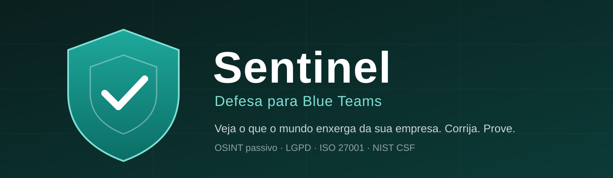

### Cyber defense for companies, built in Portuguese

[🇧🇷 Leia em português](README.pt-BR.md) · [Open Sentinel](https://sentinel-defesa.floot.app) · [Docs](docs/) (Portuguese)

---

## What Sentinel is

**Sentinel** is a SaaS platform that shows a company what an attacker can learn about it **without breaking into anything**, then manages the fix of every problem until it is proven closed.

It works on the defender's side (**Blue Team**). It only queries public sources for the domain the owner authorizes: no port scanning, no login attempts, no attack payloads.

👉 **Live product:** https://sentinel-defesa.floot.app (the interface is in Brazilian Portuguese)

### The full loop

1. **Assess.** Sentinel maps the domain's public exposure: email, DNS, certificates, subdomains, website, breaches, lookalike domains, credentials in public code.
2. **Prioritize.** Each problem becomes a finding with a CVSS severity, a plain-language explanation and step-by-step remediation.
3. **Delegate.** The owner assigns a finding to a Blue Team member with a due date. The member gets a personal link (no email, no login) and sees only their own work.
4. **Prove.** Marking a finding as fixed requires written evidence. A new assessment checks that the problem is gone and closes the finding automatically. If it returns, it reopens.
5. **Report.** Executive, technical and compliance reports (LGPD, ISO 27001, NIST CSF) with a SHA-256 integrity seal and a "Scope and limits of this assessment" section.

### What works today

| Area | What it delivers |
|---|---|
| Passive OSINT assessment | 44 checks: SPF, DMARC, DKIM, MTA-STS, CAA, DNSSEC, certificates, subdomain takeover, HTTPS, security headers, cookies, exposed sensitive files, `security.txt`, domain breaches, lookalike domains and credentials in public repositories |
| Findings | Full lifecycle with owner, due date, comments, mandatory evidence, automatic close and reopen |
| Blue Team roster | Ethical-hacker rules: nobody becomes active without accepting the authorization term (scope, rules of engagement, confidentiality, Brazilian law 12.737/2012 and LGPD). Invite links and an audit trail |
| Reports | Executive, technical and compliance, with a SHA-256 hash |
| Password hygiene | In-browser check against the NCSC list of the 100k most-used passwords. The password is never sent or stored |
| Commercial | Subscription plans (Stripe, in BRL), an owner area with a sales funnel, proposal generator and a demo mode with a fictional company |

Check details: [docs/assessment-engine.md](docs/assessment-engine.md) (Portuguese).

### What Sentinel is **not**

- It is not a penetration test. It is a passive assessment of public exposure.
- It does not find internal, code-level or configuration flaws that are not visible from outside.
- It does not replace an audit or consulting. It produces evidence and organizes the fix.

Full limits: [docs/ethics-and-scope.md](docs/ethics-and-scope.md). They are also printed in every client report.

---

## Tech stack

Hosted on [Floot](https://floot.com): React 19 with TypeScript, serverless endpoints, PostgreSQL (Kysely), Zod validation, Stripe subscriptions. Sources queried: DNS over HTTPS (Cloudflare), public certificate-transparency logs (crt.sh, with CertSpotter as a fallback), the public Have I Been Pwned breaches API and GitHub code search.

Architecture overview: [docs/architecture.md](docs/architecture.md).

> The product's source code lives on the hosting platform and is **not public in this repository**. This repository holds Sentinel's documentation, decisions and roadmap.

## Roadmap

What is next and what has shipped: [docs/roadmap.md](docs/roadmap.md).

---

## Other fronts of the Sentinel brand

| Front | Status |
|---|---|
| **Sentinel** (defense for Blue Teams) | In production, described above |
| **Sentinel Jobs BR** (IT recruiting) | Running: own dashboard and automations, outside this repository |
| **Sentinel OS** (earlier Streamlit lab) | Archived in [docs/legacy/sentinel-os-lab](docs/legacy/sentinel-os-lab/). It was the starting point; the current product is defensive |
| **Sentinel Career** and **Sentinel Home** | Ideas, no code yet |

## Security

Found a vulnerability in Sentinel? See [SECURITY.md](SECURITY.md).

## Author and contact

**Reginaldo Soares de Vasconcelos Filho**, Information Security Analyst.

Contact: contato@sentinel-os.ia.br
