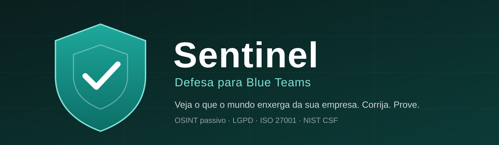

### Defesa cibernética para empresas, feita em português

[🇺🇸 Read in English](README.md) · [Acessar o Sentinel](https://sentinel-defesa.floot.app) · [Documentação](docs/)

---

## O que é o Sentinel

O **Sentinel** é uma plataforma SaaS que mostra à empresa o que um atacante consegue descobrir sobre ela **sem invadir nada**, e organiza a correção de cada problema até ficar provada.

Ele trabalha do lado de quem defende (**Blue Team**). Consulta apenas fontes públicas do domínio que o responsável autoriza: não faz varredura de portas, não tenta login, não envia payloads de ataque.

👉 **Produto no ar:** https://sentinel-defesa.floot.app

### O ciclo completo

1. **Avaliar.** O Sentinel levanta a exposição pública do domínio (e-mail, DNS, certificados, subdomínios, site, vazamentos, domínios parecidos, credenciais em código público).
2. **Priorizar.** Cada problema vira um achado com severidade (CVSS), explicação simples e passo a passo de correção.
3. **Delegar.** O responsável atribui o achado a alguém do Blue Team, com prazo. A pessoa recebe um link pessoal, sem e-mail e sem login, e vê só o que é dela.
4. **Provar.** Para marcar como corrigido é preciso registrar a evidência. Uma nova avaliação confere se o problema sumiu e fecha o achado sozinha. Se voltar, o achado reabre.
5. **Reportar.** Relatórios executivo, técnico e de conformidade (LGPD, ISO 27001, NIST CSF) com selo de integridade SHA-256 e a seção "Escopo e limites desta avaliação".

### O que já funciona

| Área | O que entrega |
|---|---|
| Avaliação OSINT passiva | 44 verificações: SPF, DMARC, DKIM, MTA-STS, CAA, DNSSEC, certificados, sequestro de subdomínio, HTTPS, cabeçalhos de segurança, cookies, arquivos sensíveis expostos, `security.txt`, vazamentos de domínio, domínios parecidos e credenciais em repositórios públicos |
| Achados | Ciclo de vida completo, com responsável, prazo, comentários, evidência obrigatória, fechamento e reabertura automáticos |
| Equipe Blue Team | Cadastro conforme a ética do hacker ético: ninguém fica ativo sem aceitar o termo de autorização (escopo, regras de engajamento, sigilo, Lei 12.737/2012 e LGPD). Convite por link e trilha de auditoria |
| Relatórios | Executivo, técnico e de conformidade, com hash SHA-256 |
| Higiene de senhas | Checagem no navegador contra a lista NCSC das 100 mil senhas mais usadas. A senha nunca é enviada nem salva |
| Comercial | Planos por assinatura (Stripe, em reais), área do proprietário com funil de vendas, gerador de proposta e modo de demonstração com empresa fictícia |

Detalhes das verificações: [docs/assessment-engine.md](docs/assessment-engine.md).

### O que o Sentinel **não** é

- Não é teste de intrusão (pentest). É uma avaliação passiva de exposição pública.
- Não encontra falhas internas, de código ou de configuração que não apareçam de fora.
- Não substitui auditoria nem consultoria. Gera evidências e organiza a correção.

Os limites completos estão em [docs/ethics-and-scope.md](docs/ethics-and-scope.md) e aparecem em todo relatório entregue ao cliente.

---

## Pilha técnica

Hospedado no [Floot](https://floot.com): React 19 com TypeScript, endpoints serverless, PostgreSQL (Kysely), validação com Zod, assinaturas via Stripe. Fontes consultadas: DNS sobre HTTPS (Cloudflare), logs públicos de certificados (crt.sh, com CertSpotter como alternativa), API pública de vazamentos do Have I Been Pwned e busca de código do GitHub.

Visão da arquitetura: [docs/architecture.md](docs/architecture.md).

> O código-fonte do produto fica na plataforma de hospedagem e **não é público neste repositório**. Este repositório reúne a documentação, as decisões e o roteiro do Sentinel.

## Roteiro

Próximos passos e o que já foi entregue: [docs/roadmap.md](docs/roadmap.md).

---

## Outras frentes da marca Sentinel

| Frente | Situação |
|---|---|
| **Sentinel** (defesa para Blue Teams) | Em produção, descrita acima |
| **Sentinel Jobs BR** (recrutamento de TI) | Em operação: painel e automações próprios, fora deste repositório |
| **Sentinel OS** (laboratório anterior em Streamlit) | Arquivado em [docs/legacy/sentinel-os-lab](docs/legacy/sentinel-os-lab/). Foi o ponto de partida; o produto atual é defensivo |
| **Sentinel Career** e **Sentinel Home** | Ideias, sem código ainda |

## Segurança

Encontrou uma falha no Sentinel? Veja [SECURITY.md](SECURITY.md).

## Autor e contato

**Reginaldo Soares de Vasconcelos Filho**, Analista de Segurança da Informação.

Contato: contato@sentinel-os.ia.br
